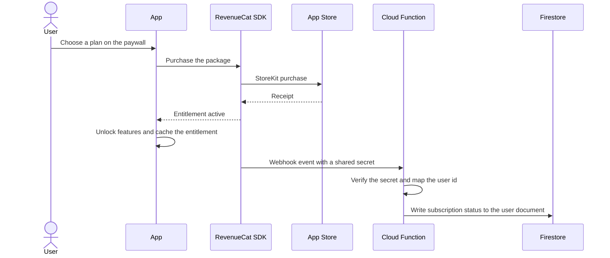

# Nárm architecture notes

Companion to the [README](README.md). The source is private; this describes how the shipped app is put together.

## Components

The app is a Flutter client that calls Firebase services directly with the signed-in user's identity. There is no custom API server. The pieces:

| Component | Role |
|---|---|
| Firebase Auth | Email, Google and Sign in with Apple. Guest mode exists behind a flag and is off. |
| Cloud Firestore | One document per user, a scan history subcollection under it, a read-only reference collection of fabrics, and a separate collection of anonymized research contributions. |
| Cloud Storage | Garment photos under the user's own path, and anonymized research images under random ids. |
| Vertex AI via Firebase AI Logic | The vision call, made from the device with the user's Firebase identity and no API key in the binary. |
| Cloud Functions (Node 20) | Two functions: the RevenueCat webhook and the account deletion cascade. |
| RevenueCat and StoreKit | Purchases, receipt validation and entitlements. Dormant in the current free release. |

## A scan

1. The user picks Label or Garment mode and takes a photo or imports one.
2. The image is downscaled and compressed on the device before anything is uploaded.
3. The app combines the image with the saved profile (skin conditions, allergies, climate, sustainability preference) and sends it to a two-stage vision pipeline that reads the label and then identifies materials.
4. The response is validated. An unreadable label, a photo with no garment, a timeout and a malformed response each produce a specific message and a retry that suggests the other scan mode.
5. The scan is written to the user's own history collection, and only then displayed, so the history never disagrees with what the user saw.
6. If the user opted in to research, an anonymized copy of the image and result is stored separately with no link back to the account, except a private list on the user's own record so deletion can clean it up.

Each scan is one model call. The usage counter increments only after a scan is saved, so cancelled or failed scans are not counted against any limit.

## A subscription purchase

Subscriptions are implemented but switched off in the current release. This is the flow when the paid tier is on.

The app binds the RevenueCat customer to the Firebase user id at sign-in, so a purchase follows the account across devices. The client reads its entitlement from the RevenueCat SDK and unlocks paywalled features immediately. In parallel, RevenueCat calls a Cloud Function with a shared secret; the function verifies the secret with a constant-time comparison and writes the subscription status onto the user's record with the Admin SDK. Security rules reject any client write to those fields. When a free trial starts, the app schedules local notifications on the device before the trial converts to a charge.

## Security model

- A user can read and write only their own record and their own scan history, and can never delete the record itself. Deletion goes through Firebase Auth, and a Cloud Function cascades it to Firestore and Storage.
- Subscription fields on the user record are server-only. Clients cannot write them.
- Research contributions are write-only from the client and stored under random ids with no account reference.
- The reference list of fabrics is read-only for everyone.
- Rules are evaluated from the document path, so the per-user checks cost no extra reads.
- The model is called through Firebase AI Logic with the user's Firebase identity. There is no model API key in the app.

## Feature flags

The paid tier, guest mode and email verification each sit behind a single flag. Turning the paid tier off made the paywall, scan limit and trial reminders inert without deleting any of the code, and the webhook function stays deployed but ignores events. The paid build is preserved in version control.

## Generated versus hand-written

The project was exported from FlutterFlow on June 1, 2026. The FlutterFlow runtime, auth plumbing, navigation scaffold and data model classes remain as generated. The onboarding flow, scanner, analysis page, paywall, billing layer, account flows and both Cloud Functions were written by hand after the export. Of about 38,000 lines of Dart, roughly 16,000 are hand-written.
