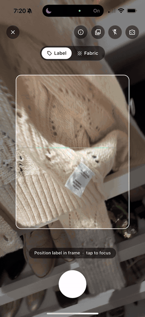
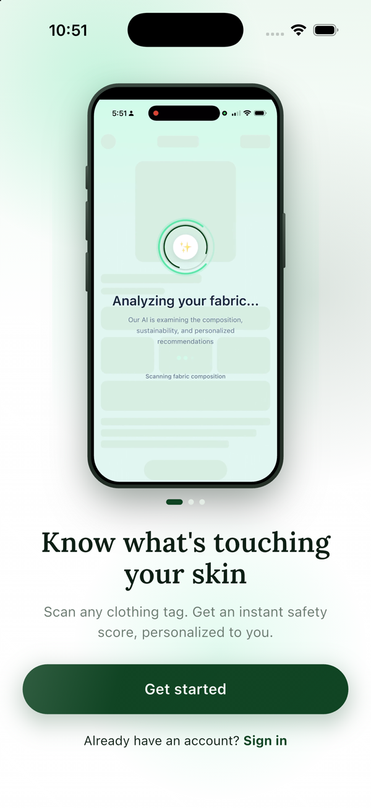
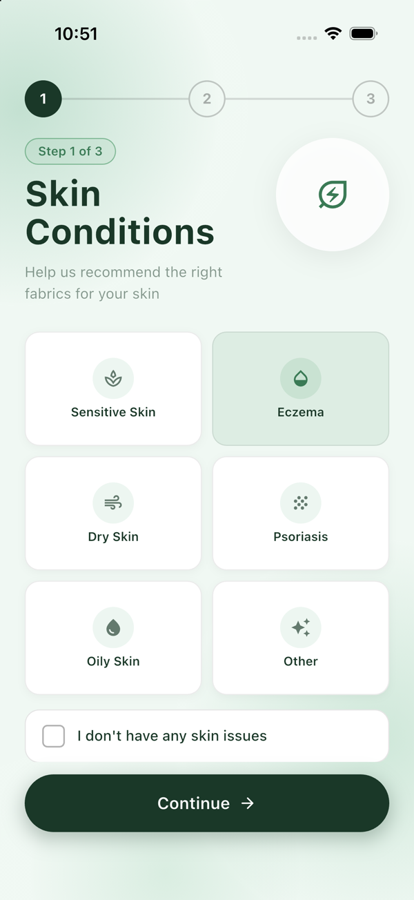
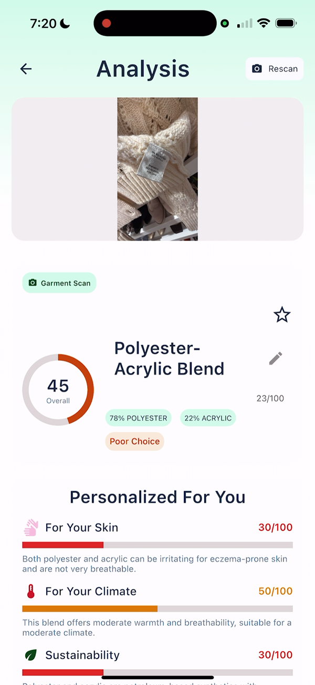
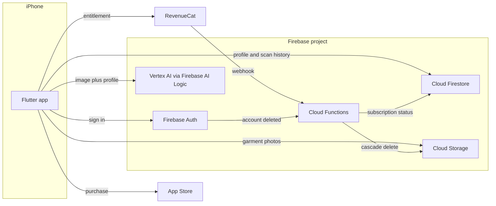
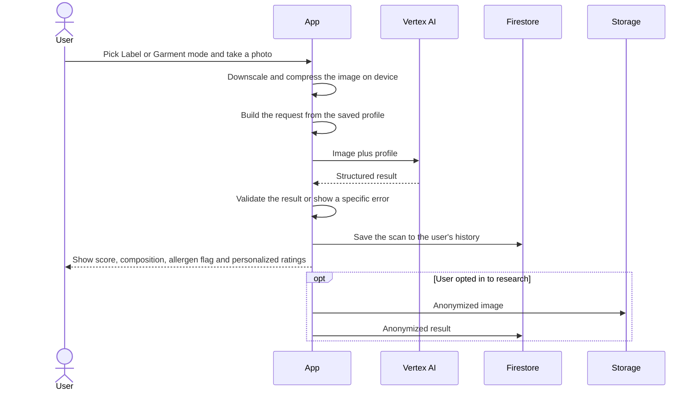
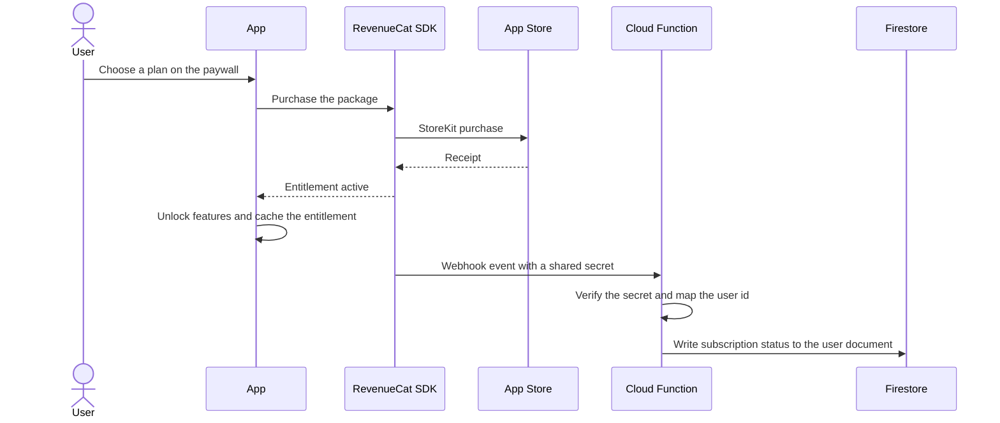

# Nárm

Scan a garment or its care label, see what it is made of, and learn how that fabric suits your skin, allergies and climate.

Nárm is listed on the App Store as "Narm: Clothing Fabric Scanner". This repository documents the architecture. The source code is private and is not published here.

## Demo

| Onboarding | Profile setup | Allergens |
|---|---|---|
|  |  |  |

| Scan | Result | Result detail |
|---|---|---|
|  |  |  |

## What it does

- Point the camera at a care label. The app reads the fiber composition and names the fabric.
- No label? Photograph the garment instead and the app estimates the material from the photo.
- Every result is scored against your profile: skin conditions, allergies, climate and how much sustainability matters to you.
- The result flags allergen risks, rates the fabric for everyday wear, exercise, loungewear and formal use, and gives a short bottom line and a shopping tip.
- Scans are saved to a history with favorites and a wardrobe, and the profile can be edited at any time.

## Results

| Measure | Value |
|---|---|
| Label reading accuracy | 98% |
| Material identification accuracy | 94% |
| Downloads | 200+ |
| Subscriptions | 48 |

TODO: describe how accuracy was measured (size of the test set, how ground truth was established, and who labeled it). The codebase does not contain the evaluation.

## Architecture

The app talks to Firebase directly from the device. There is no custom API server. Two Cloud Functions handle the work that must not run on the client: mirroring subscription status and cascading account deletion.

### A scan

The user picks Label or Garment mode and takes a photo or chooses one from the library. The image is downscaled and compressed on the device before anything leaves the phone. The app combines the image with the saved profile and sends it to a two-stage vision pipeline that reads the label and then identifies materials, running on Gemini through the Firebase Vertex AI client SDK with the user's Firebase identity. The response is validated before it is shown; an unreadable label, a photo with no garment, a timeout or a malformed response each produce a specific message and a retry. The scan is written to the user's own history collection and only then displayed, so the history never disagrees with what the user saw. If the user has opted in, an anonymized copy of the image and result is stored separately with no link back to the account, except a private list on the user's own record so deletion can clean it up.

### A subscription purchase

Subscriptions are implemented but switched off in the current release. The app is free. The flow below is what runs when the paid tier is on.

The app binds the RevenueCat customer to the Firebase user id at sign-in, so a purchase follows the account across devices. The client reads its entitlement from the RevenueCat SDK and unlocks the paywalled features immediately. In parallel, RevenueCat calls a Cloud Function with a shared secret; the function verifies the secret with a constant-time comparison and writes the subscription status onto the user's record using the Admin SDK. Security rules reject any client write to those fields, so the server-side copy cannot be tampered with. When a free trial starts, the app schedules local notifications on the device before the trial converts to a charge.

## Tech stack

| Layer | Technology | Why |
|---|---|---|
| Client | Flutter, Dart | One codebase, native camera access, fast UI iteration |
| UI scaffolding | FlutterFlow export | Got a working prototype quickly; the generated pages were then rewritten by hand |
| Navigation | go_router | Named routes with redirects driven by auth state |
| State | provider and SharedPreferences | Small app, no need for a heavier framework; profile and scan mode persist across launches |
| Auth | Firebase Auth with email, Google and Apple | Sign in with Apple is required on iOS; Firebase gives all three with one user model |
| Database | Cloud Firestore | Per-user documents map cleanly onto security rules; offline cache for history |
| Files | Cloud Storage | Garment photos and anonymized research images, gated by the same identity |
| AI | Gemini 2.5 Flash Lite through the Firebase Vertex AI client SDK | Vision plus structured output at low cost per call, authenticated by the Firebase user with no API key in the app |
| Serverless | Cloud Functions, Node 20 | Only two jobs need a trusted environment: the webhook and account deletion |
| Payments | RevenueCat and StoreKit | Receipt validation, trial eligibility and cross-device entitlement without running my own server |
| Camera | camera and image_picker plugins | Live preview with tap to focus and flash, plus photo library import |
| Distribution | TestFlight and App Store Connect from the command line | Builds and uploads are scripted; no CI service yet |

## Engineering decisions

**Serverless backend instead of an API server.** Firebase Auth, Firestore, Storage and the Vertex AI SDK are called straight from the device. The alternative was a small API in front of everything. The tradeoff is that business rules live in security rules and client code rather than one place, in exchange for no servers to run and nothing to scale by hand.

**Model called from the client SDK, not a Cloud Function.** Firebase AI Logic lets the app call Gemini with the user's Firebase identity and no API key in the binary. A Cloud Function in the middle would have added a hop and cold starts. The tradeoff is that changing the pipeline needs an app release, and server-side controls such as per-user quotas and request logging are harder. Moving the call behind a function is on the list below.

**Subscription status mirrored by a webhook, not written by the client.** The app trusts the RevenueCat SDK for what to unlock, but the server-side record of who is subscribed is written only by the webhook with the Admin SDK, and the rules forbid clients from touching those fields. The alternative, letting the client write its own status, would have been simpler and tamper-prone.

**Per-user isolation in the rules.** A user can read and write only their own record and their own scan history, and can never delete the record itself. Research contributions are write-only from the client and are stored under random ids with no account reference. The reference list of fabrics is read-only for everyone. Rules are evaluated from the document path, so the wardrobe check costs no extra reads.

**Cost per scan is bounded on the device.** Images are downscaled and compressed before upload, each scan is one model call, and the usage counter increments only after a scan is saved, so cancelled or failed scans are not counted. A monthly scan limit and paywall exist behind a feature flag; they were on during the paid period and are off now.

**Model failures are handled as product states, not crashes.** The call has a timeout, the response is checked for the expected structure, and "no label found" and "no garment found" are distinct outcomes with their own copy and a retry that suggests the other scan mode. Results are shown only after the scan is persisted. The whole paid tier, guest mode and email verification are each behind a single flag, which is how the app went free in one change.

## What I would do next

- Cache repeat scans by image hash so the same label is not analyzed twice.
- Move the model call behind a Cloud Function with a queue, which also enables per-user quotas and keeps the pipeline off the device.
- Build an evaluation set of labeled care tags and garment photos and run it on every pipeline change to catch accuracy regressions.
- Add unit and integration tests and a CI pipeline; today there is one smoke test and builds are run by hand.

## About the build

I am the technical co-founder and sole engineer. Nárm started as a Harvard Medical School capstone.

The first version was built in FlutterFlow (TODO: start date). On June 1, 2026 I exported it to Flutter and rebuilt it by hand: the onboarding flow, scanner, analysis page, paywall, billing layer, account flows and Cloud Functions are hand-written, while the FlutterFlow runtime, auth plumbing and data model classes remain as generated. The codebase is about 38,000 lines of Dart; roughly 16,000 of those were written by hand and the rest are generated scaffolding, some of it edited. The first TestFlight build shipped on June 4, 2026, version 1.0.1 was approved for the App Store in July 2026 (TODO: confirm the release date), and the app switched to a free model in October 2026.

## Status and ownership

The source code and all assets are private and owned by Narm Inc. All rights reserved. This repository documents the architecture only; see LICENSE.

## Not medical advice

Nárm offers general information about fabrics. It is not medical advice and does not replace a clinician.

## Contact

- Email: TODO_CONTACT_EMAIL
- Website: [maclanezich.com](https://maclanezich.com)
- LinkedIn: TODO_LINKEDIN_URL
