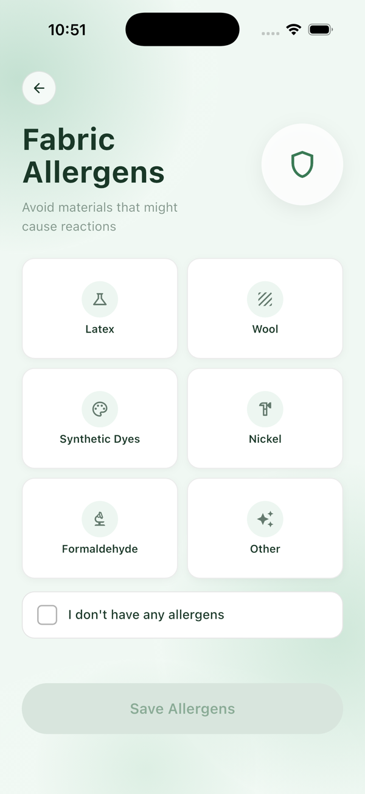
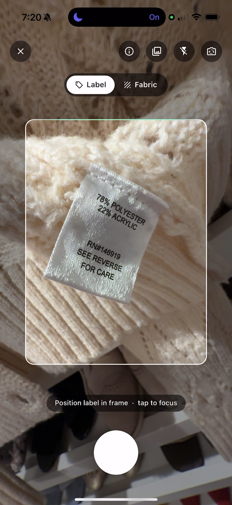
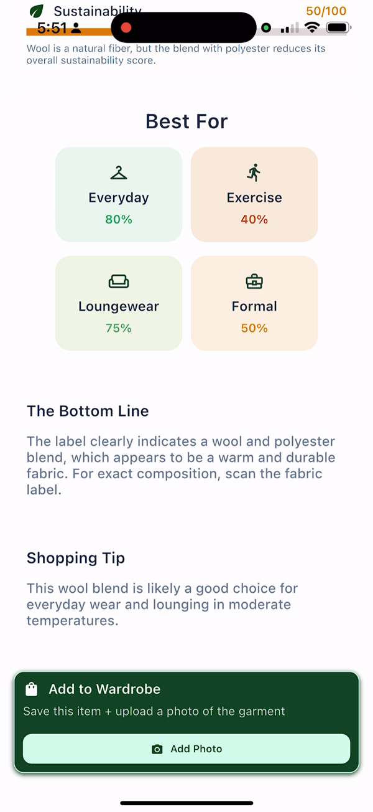
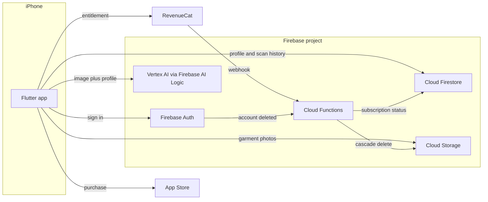
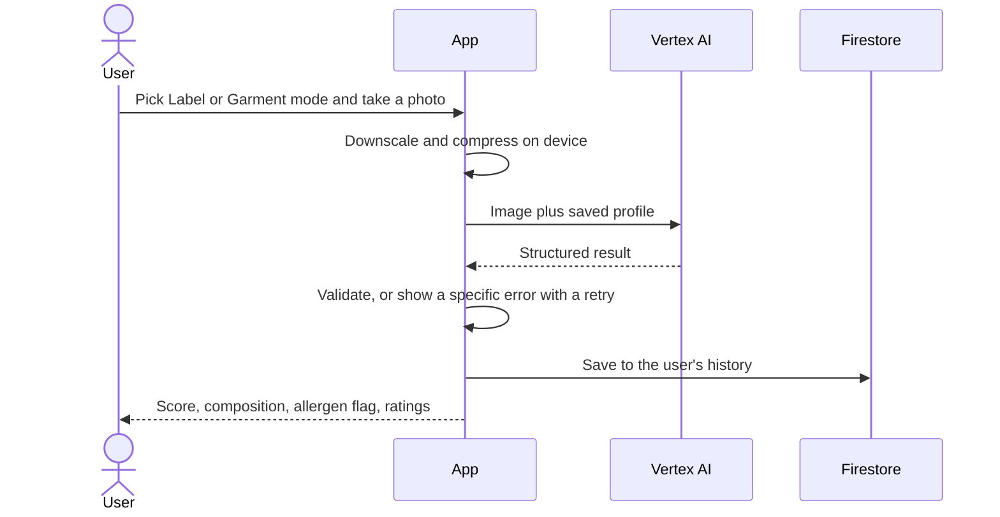

# Nárm

Scan a garment or its care label, see what it is made of, and learn how that fabric suits your skin, allergies and climate.

- **What it does.** Point the camera at a care label or a garment. The app names the fabric, flags allergen risks and scores it against your skin conditions, allergies and climate.
- **What I built.** Technical co-founder and sole engineer: the Flutter client, Firebase backend, Cloud Functions, billing layer and App Store release. The first version was scaffolded in FlutterFlow and then rewritten by hand.
- **One number.** 98% label-reading accuracy and 94% material-identification accuracy on the internal test set, 200+ downloads, 48 subscriptions during the paid period.

Listed on the App Store as "Narm: Clothing Fabric Scanner". The source code is private; this repository documents the architecture. Deeper detail is in [ARCHITECTURE.md](ARCHITECTURE.md).

## Screens

| Onboarding | Profile setup | Allergens |
|---|---|---|
|  |  |  |

| Scan | Result | Result detail |
|---|---|---|
|  |  |  |

## Architecture

The app talks to Firebase directly from the device. There is no custom API server. Two Cloud Functions handle the work that must not run on the client: mirroring subscription status and cascading account deletion.

A scan, end to end:

The image is compressed on the phone before anything is uploaded, then sent with the saved profile to a two-stage vision pipeline that reads the label and then identifies materials. The response is validated before it is shown, and the scan is persisted before it is displayed, so history never disagrees with what the user saw. The subscription flow and the security model are in [ARCHITECTURE.md](ARCHITECTURE.md).

## Engineering decisions

- **Serverless backend, no API server.** Nothing to run or scale by hand; in exchange, business rules are split between security rules and client code.
- **Model called from the client SDK, not a Cloud Function.** No extra hop or cold start, and no API key in the binary; in exchange, pipeline changes need an app release and per-user quotas are harder.
- **Subscription status written only by a webhook.** The client trusts the RevenueCat SDK for what to unlock, but the server-side record is written by a Cloud Function and rules reject client writes to those fields; the simpler alternative was tamper-prone.
- **Per-user isolation in the rules.** A user can read and write only their own record and history and can never delete the record itself; research contributions are write-only and keyed by random ids.
- **Model failures are product states.** Timeouts, malformed responses, "no label found" and "no garment found" each have their own copy and retry; nothing is shown until the scan is saved.
- **Whole features behind single flags.** The paid tier, guest mode and email verification each sit behind one flag, which is how the app went free in one change.

## Tech stack

| Layer | Technology |
|---|---|
| Client | Flutter, Dart; UI scaffolded in FlutterFlow, then rewritten |
| Navigation and state | go_router, provider, SharedPreferences |
| Auth | Firebase Auth with email, Google and Sign in with Apple |
| Data | Cloud Firestore, Cloud Storage |
| AI | Gemini 2.5 Flash Lite through the Firebase Vertex AI client SDK |
| Serverless | Cloud Functions, Node 20 |
| Payments | RevenueCat and StoreKit, currently switched off |
| Camera | camera and image_picker plugins |
| Distribution | TestFlight and App Store Connect, scripted from the command line |

## Running it

You cannot. The source, Firebase configuration and model prompts are private and owned by Narm Inc. The app itself is free on the [App Store](https://apps.apple.com/us/app/narm-clothing-fabric-scanner/id6769256623).

## What I would do next

- Cache repeat scans by image hash so the same label is not analyzed twice.
- Move the model call behind a Cloud Function with a queue, which also enables per-user quotas.
- Build an evaluation set of labeled care tags and garment photos and run it on every pipeline change.
- Add unit and integration tests and CI; today there is one smoke test and builds are run by hand.

## About the build

Nárm started as a Harvard Medical School capstone. The first version was built in FlutterFlow (TODO: start date). On June 1, 2026 I exported it to Flutter and rebuilt the onboarding flow, scanner, analysis page, paywall, billing layer, account flows and Cloud Functions by hand, while the FlutterFlow runtime, auth plumbing and data model classes remain as generated. About 38,000 lines of Dart in total, roughly 16,000 written by hand. First TestFlight build June 4, 2026; version 1.0.1 approved for the App Store in July 2026 (TODO: confirm the date); free model since October 2026.

TODO: describe how the accuracy figures were measured (test set size, how ground truth was established, who labeled it).

## Status and ownership

The source code and all assets are private and owned by Narm Inc. All rights reserved. This repository documents the architecture only; see [LICENSE](LICENSE).

Nárm offers general information about fabrics. It is not medical advice and does not replace a clinician.
